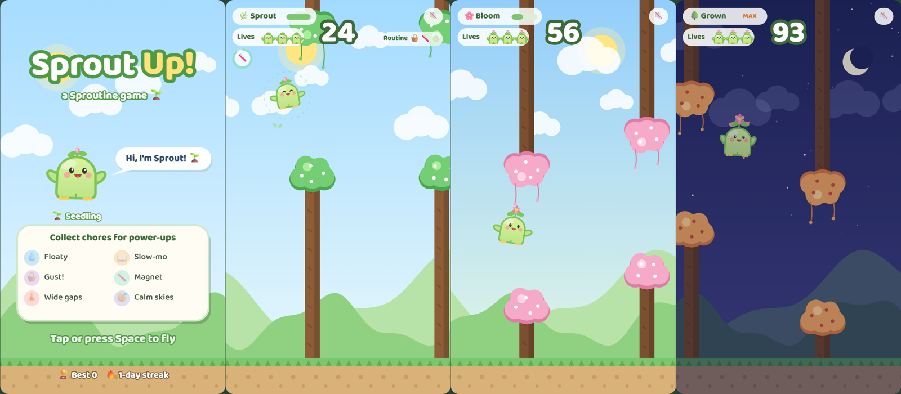

# 🌱 Sprout Up!

**A cozy tap-to-fly browser game starring Sprout, the character from the Sproutine habit app.**
Fly through the forest, collect everyday healthy habits, and watch Sprout grow from a tiny
seedling into a blooming tree, while the game gets faster and trickier.

### ▶️ [Play it now](https://hmnafidr.github.io/sproutup/)
Works in Chrome, Safari, Firefox and Edge on phone, tablet and desktop. It can be installed to the
Home Screen and plays offline.

---

## Gameplay
- **Tap / click / Space** to flap. Fly through the gaps between trees: 1 point per tree.
- **3 lives.** Every bump costs one, and Sprout visibly shrinks. Collecting 10 habits earns a life back.
- **Habits are power-ups** (+2 points each): 💧 Water, 📖 Reading, 🧺 Laundry, 🪥 Brushing teeth,
  🧘 Stretching and 😴 Sleep, each with its own effect. Three different habits in a row = **Routine Complete!** (+5).
- **Sprout grows** through 5 stages (Seedling → Sprout → Sapling → Bloom → Grown). The trees change
  with the seasons and the sky moves from sunrise to night.
- **Difficulty ramps up** in clear steps: *Breezy heights*, *Wild woods*, *Storm mode* and *Legend mode*.
  Can you reach 130?
- Best score and a daily play streak are saved on your device. No accounts, ads, analytics or cookies.

## How it's built
| | |
|---|---|
| **Language** | Vanilla JavaScript, HTML5 Canvas 2D. No framework or game engine |
| **Art** | 100% drawn in code: Sprout, trees, sky, particles and UI, with no sprite images |
| **Audio** | Sound effects synthesized live with the Web Audio API |
| **App features** | Progressive Web App: installable, works offline |
| **Pipeline** | Private source repo → automated build → published here via GitHub Actions |

Highlights include data-driven difficulty tuning, a level generator that keeps every gap physically
reachable, procedural character animation with expressions, and difficulty balanced with automated
bot playtesting.

This repository contains only the published (built) game. The source code is kept in a private
repository and **is available to employers and collaborators on request**.

## Credits & license
Created by **Nafid Rahman**. The Sprout character and the Sproutine name come from the Sproutine app and
are used with permission.

© 2026 Nafid Rahman. All rights reserved. See [LICENSE](LICENSE).
